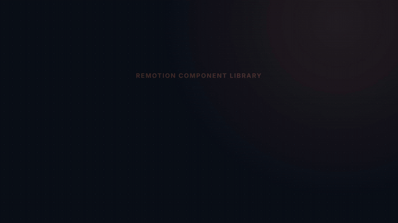

# video-generator

A library of animation components for making **explainer videos about coding, computer science, math and statistics**. It's built with Remotion, so every video is plain React code.

The goal is to make it quick to produce clear, accurate animations that help other people learn. Examples include code that highlights line by line, a request travelling through an architecture diagram, and a terminal session typing itself out. You describe the scene once, and the library handles the timing, motion and styling.

## Demo reel

[](docs/demo-reel.mp4)

A 36-second tour of the component library. Click the preview above for the full-quality MP4 ([docs/demo-reel.mp4](docs/demo-reel.mp4)). The reel is itself made with this library: see [`src/compositions/gallery/DemoReel.tsx`](src/compositions/gallery/DemoReel.tsx).

## What it uses

| Tool | Role |
|---|---|
| [Remotion](https://www.remotion.dev/) 4 | Turns React components into video: it renders each frame in headless Chrome and encodes the frames to MP4 |
| [React](https://react.dev/) 19 | Every scene and component is a React component |
| [TypeScript](https://www.typescriptlang.org/) 5 | Typed props for every component |
| `@remotion/transitions` | Cross-fades between scenes |
| `@remotion/paths` | Arrows that draw themselves, and packets that move along paths |
| `@remotion/google-fonts` | Inter and JetBrains Mono, loaded before any frame is captured |
| [prism-react-renderer](https://github.com/FormidableLabs/prism-react-renderer) | Syntax highlighting in code blocks |

## Setup

You need **Node.js 18 or newer** and an internet connection: fonts are fetched at render time, and Remotion downloads a headless Chrome the first time you render.

```bash
git clone <this repo>
cd video-generator
npm install
npm run dev          # opens Remotion Studio at http://localhost:3000
```

The Studio is a live preview where you can scrub any video frame by frame. It keeps running and rebuilds when you save a file; stop it with `Ctrl+C`.

## Rendering

```bash
# a full video
npx remotion render src/index.ts DemoReel out/demo-reel.mp4

# a single frame, which is handy for checking a layout
npx remotion still src/index.ts DemoReel out/frame.png --frame=200

npm run typecheck
```

To refresh the demo reel in `docs/` after changing components:

```bash
npx remotion render src/index.ts DemoReel docs/demo-reel.mp4
ffmpeg -i docs/demo-reel.mp4 -vf "fps=10,scale=800:-1:flags=lanczos,split[a][b];[a]palettegen=max_colors=128:stats_mode=diff[p];[b][p]paletteuse=dither=bayer:bayer_scale=4:diff_mode=rectangle" -y docs/demo-reel.gif
```

The available videos are:
- **`DemoReel`**: a tour of every component.
- **`CsGallery`**: the computer-science components, one short demo each.

## Making a video

A video is a set of scenes. A scene is a timeline: each component takes an `at` prop, which is the frame where it appears (30 frames = 1 second).

```tsx
import { anchor, Captions, colors, Scene, Title } from "../../components/core";
import { Connector, DiagramNode, Packet } from "../../components/cs";

const client = { x: 300, y: 450, w: 360, h: 110 };
const server = { x: 1260, y: 450, w: 360, h: 110 };
const wire = { from: anchor(client, "right"), to: anchor(server, "left") };

export const HttpRequest: React.FC = () => (
  <Scene grid>
    <Title title="An HTTP request" subtitle="What happens when you load a page" />
    <DiagramNode rect={client} title="Browser" icon="monitor" at={10} />
    <DiagramNode rect={server} title="Server" icon="server" accent={colors.green} at={20} />
    <Connector {...wire} at={30} color={colors.cyan} flow />
    <Packet {...wire} at={60} label="GET /" />
    <Packet {...wire} at={100} reverse color={colors.green} label="200 OK" />
    <Captions cues={[{ text: "The browser asks for the page…", at: 50 }, { text: "…and the server sends it back.", at: 95 }]} />
  </Scene>
);
```

To turn scenes into a video:
1. Put each scene in its own file under `src/compositions/<your-video>/scenes/`.
2. Chain the scenes together with `TransitionSeries`. `src/compositions/gallery/DemoReel.tsx` is a complete example.
3. Register the video as a `<Composition>` in `src/Root.tsx`. It then shows up in the Studio and can be rendered by its id.

## What's in the library

Components are organized by subject so the library can keep growing:

| Folder | Contents |
|---|---|
| `src/components/core` | Shared building blocks: theme, timing helpers, layout geometry, `Scene`, `Title`, `Captions`, `Appear`, `Typewriter`, `Badge`, `Panel`, `BulletList`, `Annotation`, `Icon` |
| `src/components/cs` | `CodeBlock`, `Terminal`, `DiagramNode`, `Boundary`, `Connector`, `Packet`, `SequenceDiagram`, `AppWindow`, `LayerStack` |
| `src/components/math` | Planned: axes, function plots, equations, vectors, matrices |
| `src/components/stats` | Planned: histograms, distributions, scatter plots, sampling |

The full documentation is in [`.claude/skills/remotion-animations/`](.claude/skills/remotion-animations/SKILL.md): the props and an example for every component, the conventions they share, and the rules that keep renders correct. Two of those rules matter from the start:
- **Animate only from the frame number.** Use `useCurrentFrame()` with `interpolate` or `spring`. Never use CSS transitions, `setTimeout` or `Math.random()`, because Remotion renders frames out of order.
- **Draw in order.** Things rendered later appear on top.

To add a component, put it in the right subject folder, export it from that folder's `index.ts`, and add a demo to the subject's gallery. It then also appears in the `DemoReel`.

## Private videos

Videos about your own projects or clients can go in `src/compositions/private/<name>/`. That folder is gitignored, and so are `public/private/` and `out/`. `Root.tsx` picks these videos up automatically, so they render locally but are never committed. See [`src/compositions/private/README.md`](src/compositions/private/README.md) for the template.

## License note

Remotion has its own license. It is free for individuals and small teams, but some companies need a paid license. See [remotion.dev/license](https://www.remotion.dev/license).
